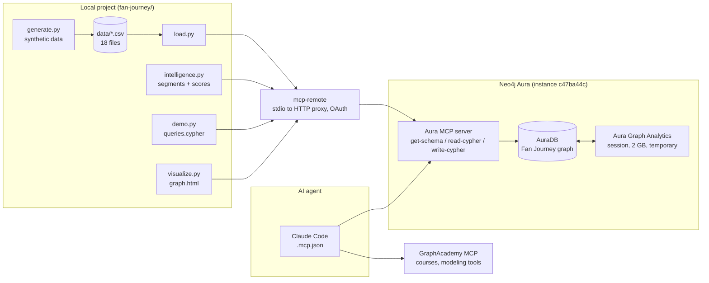
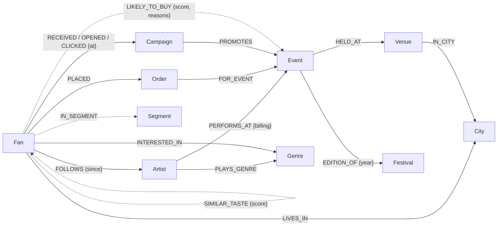

# Fan Journey Graph: Architecture

## Overview

Fan Journey is a knowledge graph of a live-events promoter's fans, built in **Neo4j Aura**. It joins three kinds of data that usually live in separate systems: ticketing, email marketing, and the artist and event catalogue.

On top of the joined data, **Aura Graph Analytics** (GDS) adds two things: fan similarity with segments, and next-best-show predictions. An AI agent (Claude Code) reaches all of it through the **Neo4j MCP server** and answers marketing questions in plain English.

## Components

| Component | File | Responsibility |
|---|---|---|
| Data generator | `generate.py` | Deterministic (seed 42) synthetic data: 3,000 fans, 40 artists, 94 events, about 8,400 orders, 28 campaigns, about 50,000 email events. Dates are anchored to the run date. Writes `data/*.csv`. |
| CSV data sources | `data/` | One file per node type and per relationship type. Node files also carry the foreign keys their relationships need, so they can be uploaded to Aura Import as-is. |
| Loader | `load.py` | Creates constraints and indexes, then loads the CSVs with batched `UNWIND … MERGE` writes (2,000 rows per batch). Two backends share the same Cypher: `McpRunner` (default) and `BoltRunner` (Python driver plus `.env`). Refuses to run on a non-empty database unless given `--reset`. |
| MCP client | `mcp_client.py` | Starts `npx mcp-remote <url>` over stdio and calls the server's tools. OAuth runs in the browser on first use, and the token is cached in `~/.mcp-auth`. |
| Intelligence | `intelligence.py` | Step 1 (`segments`): GDS Node Similarity, then Louvain, then `Segment` nodes. Step 2 (`score`): `LIKELY_TO_BUY` predictions with reasons. Both steps can be re-run safely. |
| Demo queries | `queries.cypher`, `demo.py` | 11 business queries (Q1–Q11). `demo.py` picks default parameters and prints tables. |
| Visualisation | `visualize.py` → `graph.html` | A vis-network page with two views, Schema and Fan Journey, built from live data. |
| Agent | Claude Code + `../../.mcp.json` | Uses two MCP servers: `neo4j-mcp` (the database) and `graphacademy` (learning content and modeling tools). |

## Data model

Dotted relationships are derived by `intelligence.py`. The others are source data.

| Label | Key | Notable properties |
|---|---|---|
| `Fan` | `fanId` | firstName, lastName, email, ageBand, signupDate (date), emailOptIn (bool), segmentId |
| `Order` | `orderId` | orderDate (date), tickets, totalEur, channel, attended (bool; null for future events) |
| `Event` | `eventId` | name, type (`concert` / `festival`), date, onSaleDate, priceEur |
| `Artist` | `artistId` | name, popularity (1–100) |
| `Campaign` | `campaignId` | name, type (`targeted` / `newsletter`), subject, sentAt (datetime) |
| `Segment` | `segmentId` | name, description, suggestedAction, size, topArtists, topGenres, topCities, avgSpendEur, ordersPerFan, festivalOrderPct, optInPct |
| `Venue`, `City`, `Genre`, `Festival` | `venueId`, `name`, `name`, `festivalId` | reference data |

Modeling decisions:
- **`Order` is a node, not a `(Fan)-[:BOUGHT]->(Event)` relationship.** An order has its own properties (date, tickets, value, channel, attendance) and is queried on its own, for example for attribution windows.
- **Email engagement is stored as relationships with timestamps.** `RECEIVED`, `OPENED` and `CLICKED` are each relationships with an `at` property. That keeps the journey traversable, and at this scale there's no need for a separate event store.
- **Festivals are modeled as `Festival` ← `EDITION_OF` ← `Event`.** Loyalty across editions is then a simple traversal.
- **Genre is a node.** There are few genres, they are traversed from both artists and fans, and they have no supernode risk at this size.
- **Every MERGE key has a uniqueness constraint.** Date and time values use native temporal types.

Current volumes: about 11,600 nodes and about 115,000 relationships. That includes 28,210 `SIMILAR_TASTE`, 2,795 `IN_SEGMENT` and 5,250 `LIKELY_TO_BUY` relationships.

## Data flows

**1. Load.** `generate.py` writes `data/*.csv`. `load.py` then runs the schema DDL and 18 batched `write-cypher` calls through the MCP server into AuraDB. A full load takes about 1–2 minutes.

**2. Segmentation** (`intelligence.py segments`)
1. Delete the previous derived data and drop any old projection.
2. `gds.session.getOrCreate('fanTaste', '2GB')`, then poll `gds.session.list()` until the session is `Ready` (about 2 minutes).
3. Cypher-projection `gds.graph.project(..., {sessionId})`. The taste graph is `Fan -[:LIKES {weight}]-> Artist | Festival`, where headliner-concert orders and festival orders weigh 2 and follows weigh 1. That gives 2,864 nodes and 10,579 relationships.
4. `gds.nodeSimilarity.mutate`: weighted Jaccard, topK 10, cutoff 0.05, producing `SIMILAR_TASTE`.
5. `gds.louvain.write` on `SIMILAR_TASTE`, with concurrency 1 for a repeatable result, producing `Fan.segmentId`.
6. `gds.graph.relationship.write` persists `SIMILAR_TASTE`. Then drop the graph and delete the session.
7. Communities with at least 40 members become `Segment` nodes, profiled in Cypher. Names and descriptions are then written by the agent.

**3. Scoring** (`intelligence.py score`). Per upcoming event, a single Cypher statement:
1. **Candidates:** fans connected to the event by taste similarity, follows, declared genre interest, or genre purchase history.
2. **Filter:** remove fans who already bought the event.
3. **Features:** collaborative signal, follows, genre affinity, declared interest, locality, festival loyalty, segment lift.
4. **Score:** a hand-weighted linear score, 0–100.
5. **Write:** the top 150 as `LIKELY_TO_BUY {score, reasons, computedAt}`.

No analytics session is needed for scoring. Each event finishes inside one MCP request.

**4. Agent Q&A.** A user asks Claude Code a question. Claude calls `get-schema` or `read-cypher` on `neo4j-mcp` and answers from the results. `LIKELY_TO_BUY.reasons` and the `Segment` descriptions give it ready-made explanations.

## Deployment and configuration

| Item | Value |
|---|---|
| Database | Neo4j Aura instance `c47ba44c`, with APOC, GDS (Aura Graph Analytics) and the GenAI plugin available |
| MCP endpoint | `https://c47ba44c.mcp-instances.neo4j.io`, OAuth via `aura-mcp.eu.auth0.com` |
| Claude Code config | `hackathon/.mcp.json`: `neo4j-mcp` and `graphacademy`, HTTP transport |
| Script config | MCP URL in `mcp_client.py`. Bolt credentials in `fan-journey/.env` (git-ignored) |
| Runtime | Python 3.10+ via `uv` (deps: `mcp`, `neo4j>=6.4.1`, `python-dotenv`), and Node for `npx mcp-remote` |

## Constraints and known limitations

- **MCP request timeout of about 40 seconds.** Anything slower, such as starting an analytics session, has to be started and then polled. Keep single statements small.
- **The MCP server can't serialize temporal values.** Dates come back as `{}`, so queries must `toString()` them.
- **Aura Free allows one analytics session at a time, up to 2 GB.** A session started implicitly by a projection is deleted when its last graph is dropped.
- **Scores are heuristic.** The weights aren't trained or validated, and synthetic data can't validate them anyway.
- **Data is static.** There's no incremental ingestion; re-scoring is a manual step.
- **No access control or PII handling.** All data is synthetic, and the emails use `example.com`.
